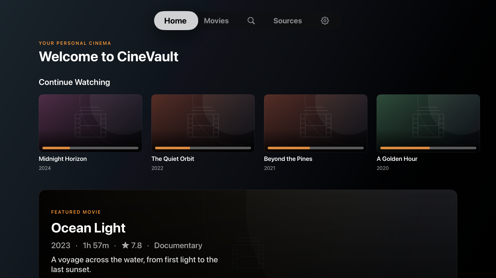
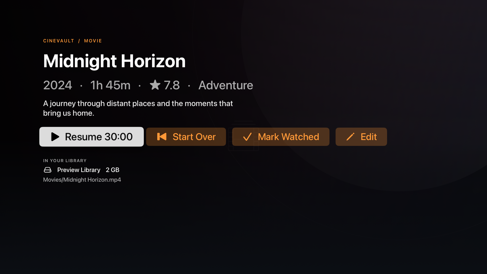

# CineVault

A Plex-style movie library for **Apple TV** that reads your movies **directly from a NAS over SMB** — no media server, no transcoding box. Native tvOS SwiftUI app.

## Features

- Add one or more NAS sources (SMB2/3: Synology, QNAP, TrueNAS, Windows shares…). Passwords live in the Keychain.
- Recursive scan for movie files; skips samples, trailers, extras and NAS metadata folders (`@eaDir`, `#recycle`, …).
- Smart filename parsing (`The.Matrix.1999.1080p.BluRay.x264-GRP.mkv` → *The Matrix (1999)*), folder fallback (`Heat (1995)/movie.mkv`) and `{tmdb-123}` tags.
- Posters, backdrops, overview, genres, runtime and rating from TMDB (your own free API key).
- Cinematic Apple TV browsing with backdrop artwork, landscape Continue Watching cards, focus-aware posters, a movie detail screen, and a dark, uncluttered interface.
- Home (Continue Watching / Recently Added / Unwatched), full library grid with sort + filter + genre, and search.
- Streaming playback with AVPlayer via a custom resource loader that serves byte ranges straight from SMB — instant start and seeking, nothing is downloaded first.
- Resume position, watched state (auto at 92%), progress bars.
- Manage entries: rename, fix match (search TMDB and pick), hide, reset progress, reset to file name.
- Library persisted with SwiftData.

### Format support

tvOS' built-in player plays **MP4 / M4V / MOV** (H.264, HEVC, AAC, AC3/E-AC3). MKV/AVI etc. are listed but show a "format not supported" message. Remux them losslessly on the NAS, e.g. `ffmpeg -i in.mkv -c copy -map 0 out.mp4`. (VLCKit could be added later as a fallback player.)

## Screenshots

Apple TV simulator previews with a sample library and placeholder artwork:

**Home**



**Movie details**



## Project layout

| Path | What |
|---|---|
| `project.yml` | XcodeGen spec — the Xcode project is generated, not committed |
| `CineVault/` | tvOS app (SwiftUI, SwiftData, AVKit) |
| `Packages/CineVaultCore/` | Pure Swift logic (filename parser, file filter, TMDB models, title matcher) + unit tests |
| `scripts/generate_app_icons.py` | Generates the layered tvOS icons / top-shelf images (stdlib only) |
| `.github/workflows/ci.yml` | Core tests + unsigned tvOS build on every push/PR |
| `.github/workflows/nas-integration.yml` | Simulator tests against a temporary local SMB fixture |
| `.github/workflows/ui-preview.yml` | On-demand Apple TV simulator screenshots with a sample library |
| `.github/workflows/testflight.yml` | Signed build + TestFlight upload (manual or `v*` tag) |
| `fastlane/Fastfile` | `beta` lane used by the TestFlight workflow |

Dependencies: [AMSMB2](https://github.com/amosavian/AMSMB2) (SMB client). It wraps libsmb2 (LGPL‑2.1); its SwiftPM product is a **dynamic** framework, so it ships as a separate, replaceable `AMSMB2.framework` inside the app, as LGPL requires.

## Building without a Mac

Everything builds on GitHub's macOS runners:

1. Push to `main` → **CI** runs `swift test` for the core package and an unsigned tvOS build.
2. Run **TestFlight** (Actions → TestFlight → Run workflow, or push a tag like `v1.0.0`) → signed build is uploaded to App Store Connect.

For a visual check without a Mac, run **UI preview** from the Actions tab and download the
`cinevault-ui-preview` artifact. It captures the home and movie detail screens using an
in-memory sample library with placeholder artwork; it never connects to a NAS or changes
your real collection. The workflow checks for screen-specific text before accepting each
capture, and uploads diagnostic screenshots if a preview fails.

On a Mac you can also do it locally: `brew install xcodegen && python3 scripts/generate_app_icons.py && xcodegen generate && open CineVault.xcodeproj`.

## One-time Apple setup (all doable from Windows)

You need a paid Apple Developer account.

1. **Bundle ID** — developer.apple.com → Certificates, IDs & Profiles → Identifiers → **+** → App IDs → App, bundle ID `com.dineshdevkota.cinevault` (or your own; then set repo **variable** `APP_BUNDLE_ID`).
2. **App record** — appstoreconnect.apple.com → Apps → **+** → New App, platform **tvOS**, same bundle ID.
3. **App Store Connect API key** — App Store Connect → Users and Access → Integrations → App Store Connect API → generate a key with **App Manager** role. Note the *Key ID* and *Issuer ID*, download the `.p8`.
4. **Distribution certificate** — run these OpenSSL commands (e.g. in Git Bash) from a private folder **outside the repository**. Keep the `.key`, `.p12`, `.p8`, and password private:
   ```bash
   openssl genrsa -out dist.key 2048
   openssl req -new -key dist.key -out dist.csr -subj "/emailAddress=you@example.com/CN=CineVault/C=US"
   ```
   developer.apple.com → Certificates → **+** → *Apple Distribution* → upload `dist.csr`, download `distribution.cer`, then:
   ```bash
   openssl x509 -inform DER -in distribution.cer -out dist.pem
   openssl pkcs12 -export -legacy -inkey dist.key -in dist.pem -out dist.p12 -passout pass:CHOOSE_A_PASSWORD
   ```
   (Drop `-legacy` if your OpenSSL is older than 3.0.)
5. **Repository secrets** (GitHub → Settings → Secrets and variables → Actions):

   | Secret | Value |
   |---|---|
   | `ASC_KEY_ID` | API key ID |
   | `ASC_ISSUER_ID` | API issuer ID |
   | `ASC_KEY_P8_BASE64` | base64 of the `.p8` file |
   | `APPLE_TEAM_ID` | 10-char Team ID (Membership page) |
   | `DIST_CERT_P12_BASE64` | base64 of `dist.p12` |
   | `DIST_CERT_PASSWORD` | the p12 password |

   Base64 on Windows PowerShell: `[Convert]::ToBase64String([IO.File]::ReadAllBytes("dist.p12")) | Set-Clipboard`.

The provisioning profile is created/reused automatically by fastlane through the API key. Build numbers come from the workflow run number.

## Installing on Apple TV (TestFlight)

1. After the TestFlight workflow succeeds, wait for processing in App Store Connect (≈10–30 min).
2. App Store Connect → your app → **TestFlight** → add yourself as an internal tester.
3. On the Apple TV install **TestFlight** from the App Store, sign in with the same Apple ID, install **CineVault**. Internal builds expire after 90 days — just re-run the workflow.

## Publishing to the App Store

1. First install the TestFlight build and verify connecting to your NAS, browsing, and playing a movie on a real Apple TV.
2. In App Store Connect, open your app's **tvOS** version and complete its description, screenshots, age rating, pricing, availability, support and privacy information. The simulator screenshots in `docs/screenshots/` use a sample library.
3. Add App Review notes explaining that the app needs an SMB share, and provide a safe way for reviewers to exercise the app. Do not put private NAS credentials in the repository.
4. Select the processed build in the **Build** section, choose **Add for Review**, and then **Submit for Review**. After Apple approves it, release it according to the availability option you selected.

## Using the app

1. **Settings** → paste your TMDB key (themoviedb.org → Settings → API; the v3 key or the v4 "read access token" both work).
2. **Sources** → *Add NAS Source*: host/IP, username/password (empty = guest), share (use *List Shares*), and the folder inside the share (e.g. `Movies`). *Test Connection*, then *Save & Scan*.
3. Browse **Home** / **Movies**, press a poster to see details and play. Long scans run in the background; rescans happen on launch.
4. Wrong poster? Open the movie → **Edit** → *Fix Match* and pick the right result, or rename it. Use *Hidden from library* to hide entries (see them under Movies → Show → Hidden).

Tip: naming folders `Title (Year)/Title (Year).mp4` gives the best matches; add `{tmdb-12345}` to force one.

## Tests

```bash
cd Packages/CineVaultCore && swift test
```

The **NAS integration** workflow also checks authenticated SMB scanning, byte-range
reads, and AVPlayer playback and seeking on an Apple TV simulator. It creates a temporary
local test share with a synthetic video; it does not connect to your NAS.

*This product uses the TMDB API but is not endorsed or certified by TMDB.*
